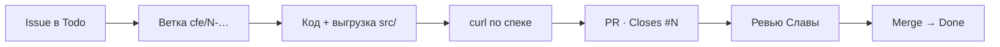

<Steps>
  <Step title="Взять задачу">
    ```powershell
    gh issue list --assignee @me
    gh issue view 1
    gh issue comment 1 --body "Взял, ветка cfe/1-catalog"
    ```
    Карточку на доске — в **In Progress**.
  </Step>
  <Step title="Ветка">
    ```powershell
    git checkout main; git pull
    git checkout -b cfe/1-catalog
    ```
  </Step>
  <Step title="Сделать и проверить">
    Правки в Конфигураторе или EDT, выгрузка в `src/`, проверка curl по [контракту](/cfe/spec).
  </Step>
  <Step title="PR">
    ```powershell
    git add src docs; git commit -m "catalog: полный каталог операций БП КЗ"
    git push -u origin cfe/1-catalog
    gh pr create --fill --base main --body "Closes #1"
    ```
  </Step>
  <Step title="Ревью и merge">
    Слава смотрит — см. [Ревью в три шага](/process/review). После merge issue закроется сам, карточка уедет в Done.
  </Step>
</Steps>

## Правила

- Один issue — одна ветка — один PR.
- Вопрос Славе — комментарий в issue, не в чат.
- Решение, которое стоит помнить, — страница в [Решения](/decisions/0001-open-core).
- Коммиты по-русски, по сути.
