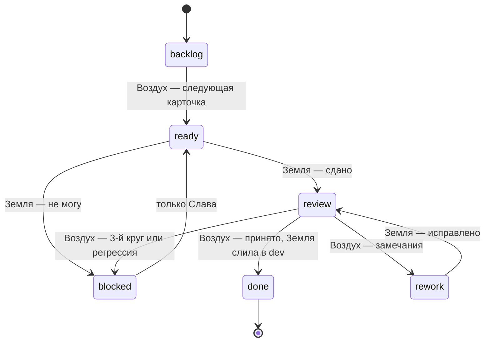

<Info>
  **Статус: проект, ещё не запущено** (13.10.2026). Сейчас конвейер работает через Paperclip — см. [Paperclip](/stand/paperclip). Эту схему запускаем с бэклога №3. Статью читают оба агента: Земля и Воздух. Действуй только в своей роли.
</Info>

## Зачем

В Paperclip (12–13.10) почти все поломки были на стыках, а не в работе: заморозки задач после оборванного рана, 409 при смене статуса, агент не будится упоминанием, сторож не срабатывает. Схема Земля–Воздух убирает оркестратор и оставляет минимум:

- **два агента, две роли**, у каждого перехода карточки — один хозяин;
- **состояние — в GitHub** (метки на issue), не в памяти агентов и не в сообщениях;
- **мосты по HTTP только будят** («посмотри карточку #12»); потерянный пинок ничего не ломает.

Почему не один агент: независимый приёмщик на более сильной модели ловит то, что исполнитель у себя не видит, и зоны разведены — Воздух не трогает 1С, Земля не принимает сама у себя.

## Роли

| | **Земля** | **Воздух** |
| --- | --- | --- |
| Кто | Claude Code на стенде 1С (Windows) | дежурный Claude Code на VM `homeos`, модель Fable |
| Делает | код расширения, загрузка через EDT-MCP, регрессия, ветка, слияние в `dev` | берёт следующую карточку, принимает или возвращает, андон |
| Доступ | репо `bilem.cfe-dev` (запись), стенд, EDT, `/lakomka-api` | issues `bilem.cfe-dev` (запись), код — чтение, MCP Bilem — чтение |
| Не делает | не принимает свою работу, не берёт карточки сам из Backlog | не пишет код, не трогает 1С и EDT, не сливает |
| Мост | earth-bridge, tailnet, `:8790` | dev-bridge (шаблон `minidesk/tools/dev-bridge`), tailnet |

**Слава** — с телефона (Remote Control / Dispatch) говорит Воздуху «запусти серию», «стоп», кладёт карточки, решает при андоне. Карточки в Backlog может класть и Claude в Cowork.

## Карточка — конечный автомат



Состояние — метка на issue: `state:backlog`, `state:ready`, `state:review`, `state:rework`, `state:blocked`; `done` — issue закрыт. Ровно одна метка `state:*` на карточке.

| Переход | Хозяин | Что делает |
| --- | --- | --- |
| `backlog → ready` | Воздух | верхняя карточка Backlog, если в работе нет другой; пинг Земле |
| `ready → review` | Земля | итог комментарием, метка, пинг Воздуху |
| `ready → blocked` | Земля | причина комментарием, метка, пинг Воздуху |
| `review → rework` | Воздух | замечания по пунктам приёмки, метка `round:N`, пинг Земле |
| `rework → review` | Земля | исправления, итог, пинг Воздуху |
| `review → done` | Воздух | «принято», пинг Земле «слей»; после слияния Земля закрывает issue |
| `* → blocked` | Воздух | андон: сообщение Славе |
| `blocked → ready` | только Слава | снять метку вручную |

**Чужие переходы не делать никогда.** Нашёл несоответствие — комментарий, без смены метки.

## Протокол мостов

Оба моста одинаковые:

```http
POST /wake
x-bridge-secret: СЕКРЕТ_МОСТА
Content-Type: application/json

{ "issue": 12, "expect": "ready", "reason": "next" }
```

- `expect` — состояние, в котором карточка должна быть: Земле шлют `ready` или `rework` (и `done` — «слей»), Воздуху — `review` или `blocked`.
- Мост **сразу отвечает 202** и ставит задание в очередь (одно на issue, повторы склеиваются). Работа — потом, в фоне.
- Проснувшись, агент **сначала читает issue в GitHub**. Метка не совпадает с `expect` — пинг устарел, ничего не делать.
- Весь результат — в GitHub (комментарий + метка). Ответ моста ничего не значит.

Секреты мостов и токены GitHub — только в `.env` на хостах. В комментарии и в чат — никогда.

## Защита от зацикливания

1. **Максимум 2 круга доработки.** Метка `round:1`, `round:2`; третий возврат — `blocked` и сообщение Славе.
2. **Идемпотентность.** Пинг с устаревшим `expect` игнорируется — повторы безвредны.
3. **Одна карточка в работе.** Воздух не выдаёт следующую, пока есть `ready`, `review` или `rework`.
4. **Дневной лимит** — не больше 15 карточек в сутки, дальше пауза до утра (Алматы).
5. **Счётчик переходов** — больше 8 смен состояния на одной карточке → `blocked`.
6. **Остывание** — повторный пинг той же карточки раньше чем через 60 с склеивается.
7. **Обход Воздуха раз в 30 минут** (страховка от потерянного пинка): `ready`/`rework` без движения больше 40 минут → пинг Земле ещё раз; ещё 40 минут тишины → `blocked`, Славе. `review` без реакции — Воздух берёт сам.

## Правила Земли

Новый агент на стенде начинает с **`docs/handoff.md`** в приватном репо `skp-kz/bilem.cfe-dev` (ветка `dev`) — передача дел: пути, инструменты, рецепт нового инструмента, контрольные цифры, секреты (только где лежат), чек-лист после перелогина. В базу знаний его не копируем: там внутренние подробности стенда.

Всё из [Paperclip → грабли](/stand/paperclip) в силе:

- Конфигуратор не используем. Загрузка — EDT-MCP `update_database` (не `fullUpdate`), заимствование — `adopt_metadata_object`.
- Проверка только через `/lakomka-api`; на `/lakomka` сервиса bilem нет.
- Ветка `cfe/00NN-имя` от свежего `dev`; перед push `git remote -v` = `skp-kz/bilem.cfe-dev`; без force; `main` не трогать.
- +0.1 версии, CHANGELOG «Не выпущено», `docs/journal.md`.
- Регрессия — все ранее принятые инструменты.
- Комментарии — из UTF-8 файла (иначе кириллица ломается на Windows).
- Итог одним комментарием: что сделано, реквизиты, вывод проверок, хэш, версия.

## Правила Воздуха

- Приёмка — по пунктам «Приёмка» карточки, своими вызовами MCP Bilem (`bilem_help` + `bilem_call`), не по отчёту Земли.
- Регрессия — выборочно 3–5 ранее принятых инструментов.
- Замечание — конкретное: пункт приёмки, вызов, что ожидалось, что пришло.
- После `done` — обновить [Что уже работает](/cfe/tools-live) и написать Славе одну строку: что теперь умеет Bilem + главная цифра проверки.
- Андон — одной строкой: «Конвейер стоит на ИНСТРУМЕНТ: ПРИЧИНА».

## Карточка (шаблон issue)

```markdown
MCP: ИНСТРУМЕНТ — что делает (бэклог №N, k/10)

Зачем: …
Параметры: …
Ответ: …
Права: …
Приёмка:
- …
- Регрессия ок.
Версия: 0.X.0
```

Метка при создании — `state:backlog`. Порядок очереди — порядок в колонке Backlog проекта на GitHub.

## Что уже есть и что сделать

| Есть | Доделать |
| --- | --- |
| earth-bridge (202, очередь, таймаут, UTF-8, PATH) | промпт: Paperclip → `gh` и метки; `expect` в пинге |
| `tools/dev-bridge` на openclaw | развернуть на `homeos` как мост Воздуха |
| Tailscale между стендом, homeos, openclaw | — |
| MCP Bilem (`bilem_help`/`bilem_call`) | доступ Воздуху |
| доска GitHub Project `bilem.ai` | метки `state:*`, `round:*`; защита ветки `main` |
| — | fine-grained токены: Земле — `bilem.cfe-dev` contents+issues, Воздуху — issues + чтение кода |
| — | канал Славе: Telegram-бот или WhatsApp через Куру |

Оценка — около дня. При переходе: в Paperclip поставить `bilem-earth` на паузу и снять у Куралай монитор и сторожей — иначе два конвейера возьмут одно и то же.

## Открытые вопросы

- Канал уведомлений Славе (Telegram-бот — одно звено; WhatsApp через Куру — привычнее).
- Под чьим аккаунтом Claude работает Земля (решение Славы — его аккаунт, перелогин на стенде).
- Нужен ли Воздуху субагент-приёмщик или хватает Fable напрямую.
