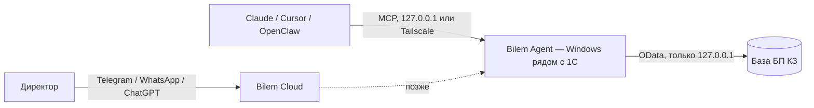

Директор пишет в мессенджер: «сколько у нас денег», «кто должен», «что по налогам» — ответ из его **1С:Бухгалтерии для Казахстана** за секунду. Утренняя сводка «три вещи». Бухгалтер видит все вопросы руководителя.

<Note>
  Білем — «знаю» по-казахски. Слово «бот» не используем. Персонажа нет — собеседник сам Bilem.
</Note>

## Принципы

<AccordionGroup>
  <Accordion title="Агент — интерфейс к базе, не собеседник" icon="database">
    Любой ответ имеет источник — инструмент 1С. Знания модели о мире не используются, интернет-поиска нет. Нет данных — честное «білмеймін».
  </Accordion>
  <Accordion title="Откуда цифра" icon="clock">
    В каждом ответе с цифрами есть `as_of` — «данные 1С на …» и дата последней выписки. Агент всегда может сказать, на какой момент цифра, и предупреждает, если выписки давно не загружали.
  </Accordion>
  <Accordion title="Не навреди учёту" icon="shield">
    Ни одной проводки. Чтение и непроведённые документы продажника. См. [решение 0002](/decisions/0002-ne-trogaem-uchet).
  </Accordion>
  <Accordion title="Данные не покидают 1С" icon="lock">
    Данные 1С не хранятся. Контекст беседы — 24 часа (настраивается). Постоянная память — только то, что человек сам попросил запомнить.
  </Accordion>
</AccordionGroup>

## Из чего состоит

| Часть | Что | Код |
|---|---|---|
| **Bilem Agent** | Программа для Windows (MSI): пользователь `bilem` только на чтение, публикация OData только для этой машины, MCP-сервер на 127.0.0.1 по токену, печатные формы, почта, обновления кнопкой | открыт (MIT), [github.com/skp-kz/bilem.ai](https://github.com/skp-kz/bilem.ai) |
| **Bilem Cloud** | Мессенджеры, ChatGPT, телефон, модель включена, адресная поддержка; кабинет app.bilem.ai | закрыт, по подписке |

Агент наружу ничего не раздаёт: MCP слушает только 127.0.0.1. Подключить ИИ с другого компьютера — дело разработчика или администратора; мы показываем способ через Tailscale ([docs.bilem.ai/connect/tailscale](https://docs.bilem.ai/connect/tailscale/)), дальше — открытый код. Прежняя схема с расширением 1С (bilem.cfe) — в архиве.

## Регион и язык

KZ сначала, затем KG и UZ — 1С там тоже везде. Ответы на русском и казахском.
