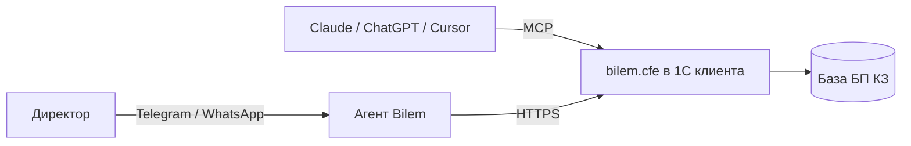

Директор пишет в мессенджер: «сколько у нас денег», «кто должен», «что по налогам» — ответ из его **1С:Бухгалтерии для Казахстана** за секунду. Утренняя сводка «три вещи». Бухгалтер видит все вопросы руководителя.

<Note>
  Білем — «знаю» по-казахски. Слово «бот» не используем. Персонажа нет — собеседник сам Bilem.
</Note>

## Принципы

<AccordionGroup>
  <Accordion title="Агент — интерфейс к базе, не собеседник" icon="database">
    Любой ответ имеет источник — инструмент 1С. Знания модели о мире не используются, интернет-поиска нет. Нет данных — честное «білмеймін».
  </Accordion>
  <Accordion title="Откуда цифра" icon="clock">
    В каждом ответе cfe есть `as_of` — дата и время данных. Агент всегда может сказать, на какой момент цифра.
  </Accordion>
  <Accordion title="Не навреди учёту" icon="shield">
    Ни одной проводки. Чтение и непроведённые документы продажника. См. [решение 0002](/decisions/0002-ne-trogaem-uchet).
  </Accordion>
  <Accordion title="Данные не покидают 1С" icon="lock">
    Данные 1С не хранятся. Контекст беседы — 24 часа (настраивается). Постоянная память — только то, что человек сам попросил запомнить.
  </Accordion>
</AccordionGroup>

## Из чего состоит

| Часть | Что | Код |
|---|---|---|
| **bilem.cfe** | Расширение 1С: REST + MCP | открыт, GitHub |
| **Облако** | Мозг, каналы, кабинет app.bilem.ai | закрыт |
| **Служба bilem-agent** | Канал к 1С без настройки руками | закрыт, позже |

## Регион и язык

KZ сначала, затем KG и UZ — 1С там тоже везде. Ответы на русском и казахском.
