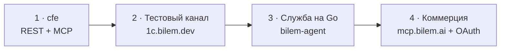

<Steps>
  <Step title="1 · cfe — сейчас" icon="cube">
    Баканов и его Claude Code пишут расширение: HTTP-сервис `/hs/bilem` и MCP в одном. Цель — богатый набор методов из [каталога](/cfe/catalog), каждый принят curl.

    **Готово, когда:** скелет (`org`, `tools`, `health`, `mcp`) + четыре вопроса директора (`balance`, `debtors`, `creditors`, `sales`) + счёт и акт сверки.
  </Step>
  <Step title="2 · Тестовый канал" icon="tower-broadcast">
    Публикация базы `lakomka` на IIS → туннель `bakanov-stand` маршрутом `1c.bilem.dev` → Cloudflare Access. Слава и его Claude подключают cfe как MCP и проверяют с Мака.

    **Готово, когда:** Claude Славы отвечает на «сколько у нас денег» из 1С на стенде.
  </Step>
  <Step title="3 · Служба на Go" icon="gears">
    `bilem-agent` — служба Windows: сама находит опубликованную 1С, держит исходящий канал к нам, привязывается кодом из кабинета, обновляется сама. Входящих портов у клиента нет.

    **Готово, когда:** установили на чистую машину — и cfe доступна снаружи без ручной настройки туннеля.
  </Step>
  <Step title="4 · Коммерция" icon="handshake">
    `mcp.bilem.ai` с OAuth (Auth0, тот же вход, что в кабинет) → клиент подключает Bilem в ChatGPT или claude.ai и говорит со своей 1С. Подпись кода — когда ставить будут чужие люди.

    **Первый пилот:** Зимин (сыроварня) — служба на его сервер, вход через Bilem, ChatGPT отвечает по его базе.
  </Step>
</Steps>

<Note>
  Каналы Telegram/WhatsApp и кабинет `app.bilem.ai` развиваются параллельно на стороне Воздуха и подключатся к cfe по тому же контракту.
</Note>
