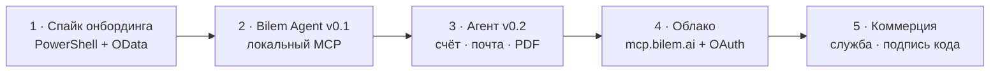

<Note>
  Обновлено 17.10.2026 по решению [0009 · OData + Bilem Agent вместо cfe](/decisions/0009-odata-agent-vmesto-cfe). Прежний путь «cfe → тестовый канал → служба на Go» заменён.
</Note>

<Steps>
  <Step title="1 · Спайк онбординга — сейчас" icon="flask">
    Земля гоняет `setup-spike.ps1` на копиях эталонной учебной базы: вход админом через COM → пользователь `bilem` → состав OData → публикация `webinst` на IIS только для 127.0.0.1 → проверка `$metadata`. Всё, что понадобилось, — в скрипт, не руками. Задача: [Спайк онбординга](/stand/agent-spike).

    **Готово, когда:** с новой копии эталона скрипт проходит до «ГОТОВО» без ручных правок, OData отвечает под `bilem` только с 127.0.0.1.
  </Step>
  <Step title="2 · Bilem Agent v0.1 — бесплатный локальный MCP" icon="desktop">
    Windows-программа (вариант A: классическое окно). Шаги спайка внутри мастера: выбрать базу → пароль админа → «Подключить». Локальный MCP с токеном и белым списком IP, инструменты `whoami`, `cash_balance`, `debtors` (сверка с cfe на той же базе), журнал, проверка доступа после обновления 1С. Кнопки «Подключить к Claude Code / Claude Desktop / Cursor».

    **Готово, когда:** ролик «три шага — и ИИ отвечает по 1С» снимается на чистой машине.
  </Step>
  <Step title="3 · Агент v0.2 — запись и документы" icon="file-invoice">
    Черновик счёта и доверенности через OData по рецепту Куралай → кнопка «Подтвердить» мимо модели → PDF своим шаблоном с логотипом → отправка по SMTP клиента.
  </Step>
  <Step title="4 · Облако" icon="cloud">
    Режим «Облако bilem» в той же программе: исходящее соединение к `mcp.bilem.ai`, OAuth (Auth0, тот же вход, что в кабинет) → ChatGPT, claude.ai, голос, Telegram/WhatsApp.

    **Первый пилот:** Зимин (сыроварня).
  </Step>
  <Step title="5 · Коммерция" icon="handshake">
    Служба Windows (работа без открытого окна), MSI, самообновление, подпись кода, права по людям и несколько баз по тарифу.
  </Step>
</Steps>

<Note>
  `bilem.cfe` заморожен: эталон для сверки ответов. Кабинет `app.bilem.ai` и каналы развиваются параллельно и подключатся к агенту по тому же контракту инструментов.
</Note>
